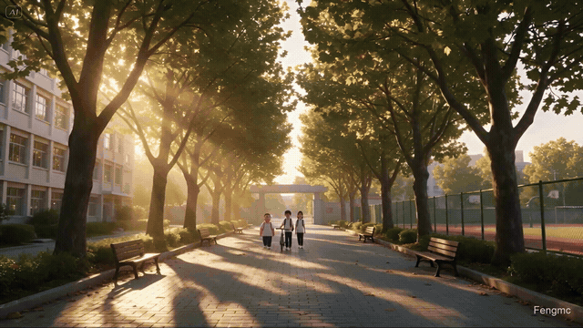
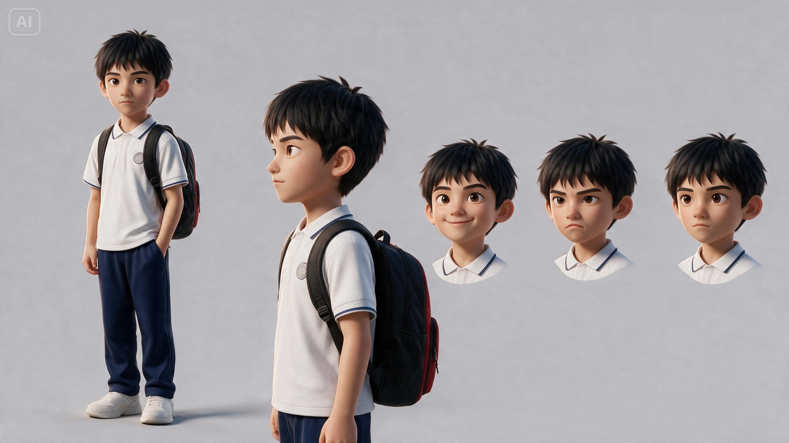
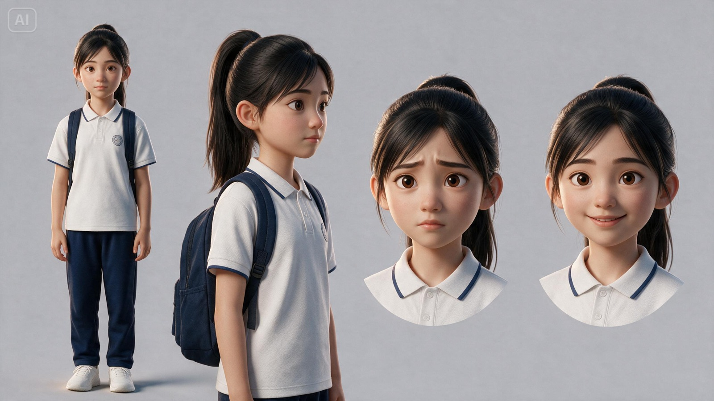
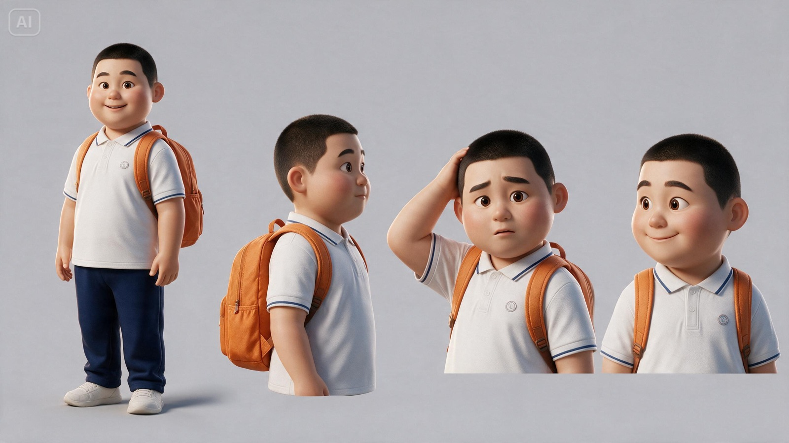
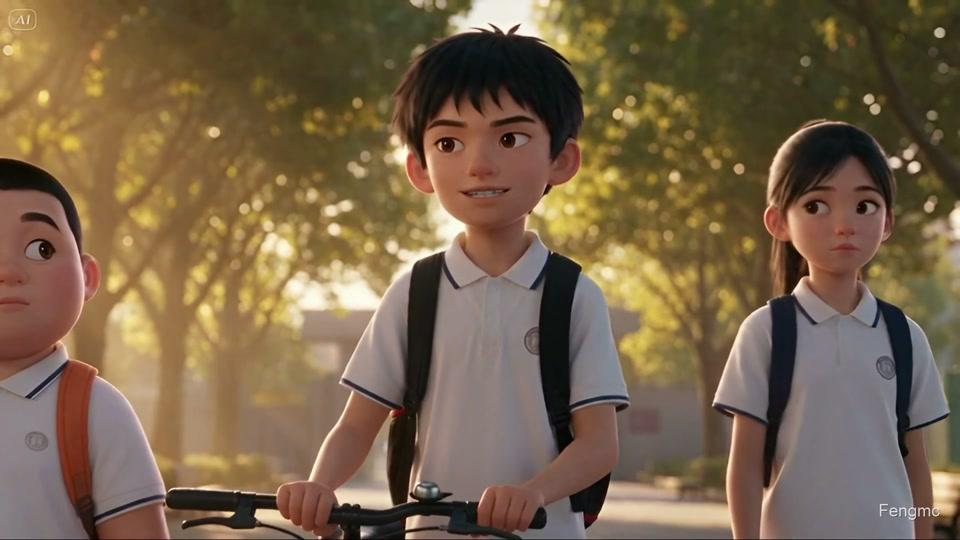
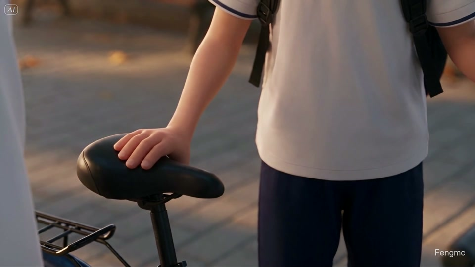
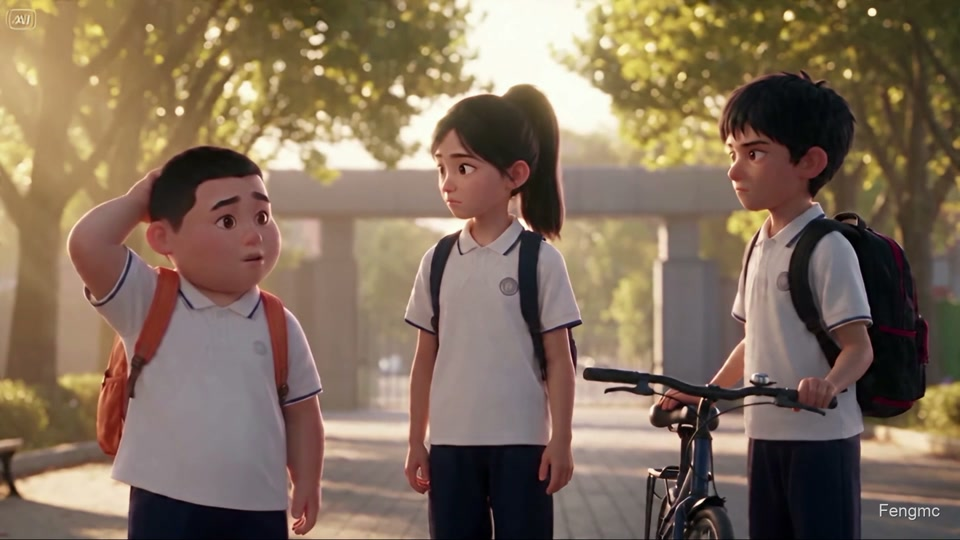
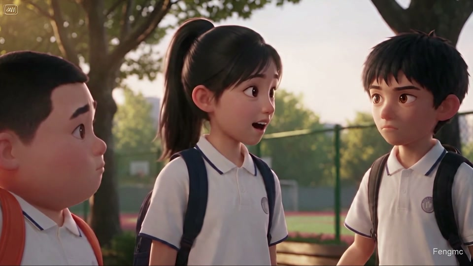
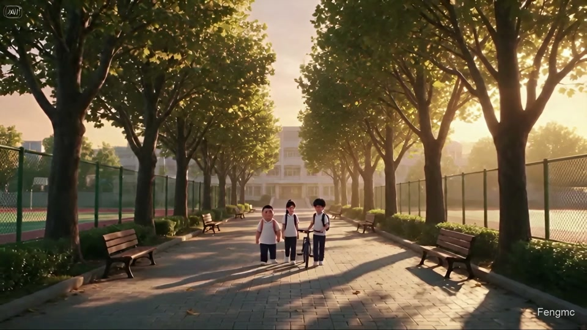
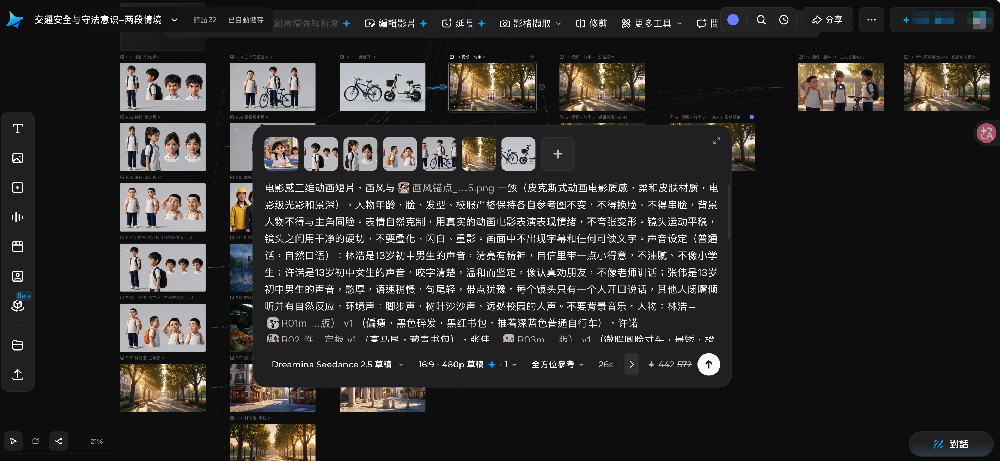

# AI Video Workflow

A short animated film, and the materials used to make it: characters, shots, prompts and local postproduction tools.

一支动画短片，以及它的制作材料：人物定妆照、分镜、提示词和本地后期工具。

**[Watch online · 在线观看](https://fengmc2001.github.io/ai-video-workflow/)** · [The making · 制作过程](#from-idea-to-film--从选题到成片) · [Use the tools · 使用工具](#try-it--动手做一支)

## The film · 成片

**The e-bike debate · 骑电动车的小争论** 
52.13s · 1920 × 1080 · 60fps · Mandarin & English / 中文原声与英文配音 · Fengmc

Three classmates are walking home. Lin Hao thinks an e-bike would make life easier; Xu Nuo and Zhang Wei have their own views. The conversation gives each of them a reason to reconsider.

林浩觉得天天骑自行车太累，想换电动车。许诺谈起上路年龄，张伟提到家长同意。三个人把话说开，也各自作出了选择。

The image above is a silent excerpt. **[Play the full film](https://fengmc2001.github.io/ai-video-workflow/#film)** in the browser, with Mandarin or English dialogue and a 1080p60 option.

上方是静音片段预览。**[点击播放完整成片](https://fengmc2001.github.io/ai-video-workflow/#film)**，在浏览器里选择中文或英文配音，可选 1080p60。

[English version · 英文版](https://fengmc2001.github.io/ai-video-workflow/?lang=en#film) · [中文原声 · Mandarin](https://fengmc2001.github.io/ai-video-workflow/?lang=zh#film) · [Release & MP4 · 成片下载](https://github.com/Fengmc2001/ai-video-workflow/releases) · [Case study · 完整案例](examples/traffic-safety/README.md)

## Meet the cast · 人物定妆照

| Lin Hao · 林浩 | Xu Nuo · 许诺 | Zhang Wei · 张伟 |
| :---: | :---: | :---: |
|  |  |  |
| Confident and a little stubborn. Willing to listen. 自信，有点爱逞强，也愿意听道理。 | Serious about the rules, warm with her friends. 认真守规则，提醒朋友时坚定而友善。 | Lively and good-natured. Likes to ask what others think. 憨厚活泼，习惯先问问大家。 |
| Tousled hair · slim build · black-and-red backpack 黑色碎发 · 偏瘦 · 黑红书包 | High ponytail · navy backpack 高马尾 · 藏青书包 | Buzz cut · round face · orange backpack 寸头 · 微胖圆脸 · 橙色书包 |

[Character notes · 人物资料](examples/traffic-safety/characters.json) · [Dialogue · 台词表](examples/traffic-safety/dialogue.json)

## The story in eight frames · 八个镜头看剧情

Frames from the finished film. Each image links to that moment in the online player.

以下取自成片。点击画面，可以在播放页跳到对应时刻。

| | |
| :--- | :--- |
| **01 · 00:02**  A walk after school 放学路上 | **02 · 00:07**  Lin Hao makes his case 林浩说出想法 |
| **03 · 00:12**  Xu Nuo raises a concern 许诺认真提醒 | **04 · 00:20**  It is only a short ride 就去附近而已 |
| **05 · 00:29**  Zhang Wei asks about permission 张伟提到家长同意 | **06 · 00:35**  Xu Nuo responds to both friends 许诺回应两个人 |
| **07 · 00:42**  Lin Hao changes his mind 林浩接受建议 | **08 · 00:50**  They walk on together 三人继续向前 |

[Shot plan · 分镜脚本](examples/traffic-safety/storyboard.json) · [G1 prompt · 前半段提示词](examples/traffic-safety/prompts/G1.md) · [G2 prompt · 后半段提示词](examples/traffic-safety/prompts/G2.md)

## Before and after · 超分前后

| Before · 480p source / 超分前原片 | After · 1080p / 超分后 |
| :---: | :---: |
|  |  |

The same frame at 8 seconds, with identical crops. The 480p source is enlarged to the same display size. RealESRGAN_x2plus supplies 85% of the final image, blended with 15% Lanczos enlargement.

两侧取自第 8 秒的同一帧，使用相同裁切。480p 原片放大到相同尺寸展示，超分采用 RealESRGAN_x2plus，按 85% 神经网络结果与 15% Lanczos 放大结果混合。

**[Move the comparison slider · 拖动滑块对比](https://fengmc2001.github.io/ai-video-workflow/#comparison)** · [Full-frame comparison · 查看全幅对照](assets/super-resolution-comparison.jpg) · [Postproduction · 后期做法](docs/06-postproduction.md)

## From idea to film · 从选题到成片

The story comes first. Character sheets and shot plans give the generators something concrete to work from; local tools handle the final picture and sound.

先想清楚故事，再做人物和分镜。参考图、台词与镜头一起交给生成工具，最后在本地处理画面和声音。

### A working canvas · 画布里的工作流

Character sheets, scene references and shot prompts sit together on the canvas. The connections show which references feed each generated clip.

人物定妆照、场景参考和逐镜提示词放在同一张画布里，连线标出每段视频用到的参考。点击截图可查看大图。

**[Open the shared Dreamina canvas · 打开共享即梦画布](https://dreamina.capcut.com/ai-tool/ai-canvas/27fb6c0e-a09a-4de9-bd64-43281ece52e2?enter_from=noew_canvas_shared_link)**

| Stage · 阶段 | What goes into it · 做什么 |
| --- | --- |
| [01 Topic · 选题](docs/01-topic.md) | Find a familiar disagreement and decide where it leads. 找一个熟悉的分歧，想清楚结尾人物会作出什么选择。 |
| [02 Characters · 人物画像](docs/02-characters.md) | Give each person a distinct look, voice and point of view. 写清外形、声音、性格，以及他为什么会这样想。 |
| [03 Story & shots · 剧情分镜](docs/03-story-and-shots.md) | Write the conversation, then plan actions and camera positions. 先写对话，再安排动作、站位和镜头。 |
| [04 Prompts · 提示词](docs/04-prompts.md) | Link characters, references and dialogue to each shot. 把角色、参考图、台词和镜头逐一对应。 |
| [05 Refinement · 局部精修](docs/05-refinement.md) | Add a line, adjust the delivery, and keep the scene flowing. 补充一句动机，调整语气，让前后接得自然。 |
| [06 Postproduction · 后期](docs/06-postproduction.md) | Interpolate, upscale, edit the audio, assemble and watermark. 插帧、超分、原声精修、合成与水印。 |

This film uses Dreamina for its images and native Mandarin dialogue. The English dub uses the official CLI with a separate voice for each character, mixed with the original ambience. The repository also includes notes for Flow and Fish Audio.

本片用即梦生成画面与中文同期声，英文版通过官方 CLI 逐角色配音，再混入原片环境声。仓库也整理了 Flow 与 Fish Audio 的使用流程，方便其他题材选用。

[English dubbing · 英文配音](docs/07-english-dub.md) · [Dreamina · 即梦](docs/providers/dreamina.md) · [Google Flow](docs/providers/flow.md) · [Fish Audio](docs/providers/fishaudio.md) · [Prompt templates · 提示词模板](prompts)

## Try it · 动手做一支

Python 3.10+ and FFmpeg. Install FFmpeg with `brew install ffmpeg` on macOS or `sudo apt-get install ffmpeg` on Ubuntu.

需要 Python 3.10+ 和 FFmpeg。安装后，可以先导出本片的提示词，再新建自己的工程。

~~~bash
git clone https://github.com/Fengmc2001/ai-video-workflow.git
cd ai-video-workflow
python -m pip install -e .

aivideo check examples/traffic-safety/project.json
aivideo prompts examples/traffic-safety/project.json --output workspaces/traffic-prompts
aivideo init workspaces/my-film --title "My animated short"
~~~

The CLI also handles local audio patches, assembly, super-resolution and watermarks.

命令行工具也可以单独完成局部换声、合成、超分和加水印。

[CLI & postproduction · 命令与后期](docs/06-postproduction.md) · [Open Colab notebook · 打开 Colab 超分笔记本](https://colab.research.google.com/github/Fengmc2001/ai-video-workflow/blob/v0.1.0/notebooks/super-resolution.ipynb) · [Showcase source · 展示页源码](site)

Code, documentation and prompts: [MIT](LICENSE). Media: [usage notes](ASSETS_LICENSE.md). Third-party code: [notices](THIRD_PARTY_NOTICES.md).

代码、文档和提示词采用 [MIT](LICENSE)。视频与美术素材见[使用说明](ASSETS_LICENSE.md)，第三方组件见[来源与授权](THIRD_PARTY_NOTICES.md)。

— Fengmc
