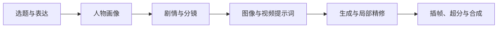

# AI Video Workflow

[](https://github.com/Fengmc2001/ai-video-workflow/actions/workflows/checks.yml)

从一个选题，做出一支有角色、有对话、有完整起承转合的动画短片。

这里整理了我制作 AI 视频时使用的流程：先写清故事要表达什么，再设计人物和场景，拆成分镜，生成画面与同期声，最后在本地完成精修、超分和合成。每一步都有对应的模板，后期工具也可以单独使用。

[](https://github.com/Fengmc2001/ai-video-workflow/releases/download/v0.1.0/traffic-safety-fengmc-1080p60.mp4)

**《骑电动车的小争论》** · 52.13 秒 · 1920×1080 · 60fps · 中文同期声 · Fengmc 水印

[完整视频](https://github.com/Fengmc2001/ai-video-workflow/releases/tag/v0.1.0) · [轻量预览](assets/demo-preview.mp4) · [这个短片怎么做](examples/traffic-safety/README.md)

## 从哪里开始



| 阶段 | 主要做什么 | 文件 |
| --- | --- | --- |
| 选题 | 确定观众、冲突和结尾的选择 | [选题](docs/01-topic.md) |
| 人物 | 写清性格、外形、声音和人物关系 | [人物画像](docs/02-characters.md) |
| 剧本 | 把观点写进对话，安排场景和动作 | [剧情与分镜](docs/03-story-and-shots.md) |
| 提示词 | 把人物、参考图、台词和镜头绑定 | [提示词设计](docs/04-prompts.md) |
| 精修 | 补充动机、调整语气、替换指定片段 | [局部精修](docs/05-refinement.md) |
| 后期 | 插帧、Real-ESRGAN 超分、原声剪辑、合成、水印 | [后期脚本](docs/06-postproduction.md) |

完整示例在 `examples/traffic-safety/`。想从自己的题材开始，可以先读[选题模板](prompts/01-topic.md)。

## 跑起来

需要 Python 3.10+ 和 FFmpeg。macOS 可以用 `brew install ffmpeg`；Ubuntu 用 `sudo apt-get install ffmpeg`。

```bash
git clone https://github.com/Fengmc2001/ai-video-workflow.git
cd ai-video-workflow
python -m pip install -e .

# 建一个新片目录
aivideo init workspaces/my-film --title "我的动画短片"

# 看完整示例，并导出上传参考与提示词
aivideo check examples/traffic-safety/project.json
aivideo prompts examples/traffic-safety/project.json --output workspaces/traffic-prompts

# 给自己的成片加水印
aivideo watermark my-film.mp4 --output my-film-fengmc.mp4 --text Fengmc
```

`aivideo --help` 可以查看全部命令。原声局部替换、镜头合成和超分的用法在[后期文档](docs/06-postproduction.md)。也可以[在 Colab 打开超分笔记本](https://colab.research.google.com/github/Fengmc2001/ai-video-workflow/blob/v0.1.0/notebooks/super-resolution.ipynb)。

## 生成工具怎么选

这次示例使用 Dreamina 生成画面和中文同期声，再做官方 60fps 内插与 RealESRGAN_x2plus 超分。Flow 和 Fish Audio 的接入方法也放在仓库中，换题材时可以按需要组合。

- [Dreamina：人物参考、分段生成、同期声](docs/providers/dreamina.md)
- [Flow：按分镜准备画面与参考素材](docs/providers/flow.md)
- [Fish Audio：按角色制作独立配音](docs/providers/fishaudio.md)

`project.json` 记录人物、台词、镜头和本地素材。换工具时沿用这份文件，重新绑定相应平台的素材即可。

## 文件结构

```text
docs/                     制作过程与工具说明
prompts/                  六个阶段的提示词模板
examples/traffic-safety/   完整短片示例
assets/                   人物、场景、声音和视频预览
src/aivideo_workflow/      本地后期命令
notebooks/                Colab 超分笔记本
tests/                    音频、时间轴与导出检查
```

代码、文档和提示词采用 [MIT](LICENSE)。示例视频与美术素材的使用方式见 [ASSETS_LICENSE.md](ASSETS_LICENSE.md)，第三方组件见 [THIRD_PARTY_NOTICES.md](THIRD_PARTY_NOTICES.md)。

— Fengmc
