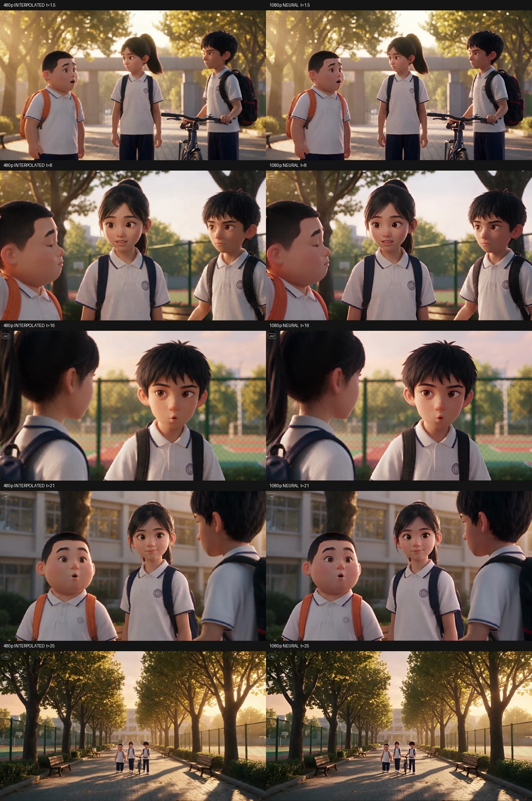

# 把画面和声音收成一支片

本片使用的顺序是：分段生成 → 官方60fps内插 → RealESRGAN_x2plus超分 → 原声精修与合成 → Fengmc水印。

## 60fps

生成后，在平台的内插工具中选择60fps，再下载原文件。也可以使用 [RIFE](https://github.com/nihui/rife-ncnn-vulkan) 在本地按镜头插帧。

插帧负责产生中间运动帧；`assemble` 负责把已有镜头放到同一时间轴。交给合成脚本前，先完成所需的运动插帧。

## 超分到1080p

安装超分依赖：

```bash
python -m pip install -e ".[superres]"
aivideo upscale media/G1-60fps.mp4   --output exports/G1-1080p60.mp4   --device cuda --width 1920 --height 1080 --strength 0.85
```

首次运行会下载官方 x2plus 权重并核对 SHA256。模型文件放在 `weights/`，不用加入 Git。

本例先用神经网络放大两倍，再调整至1920×1080；85%的神经网络结果与15%的普通放大结果混合。画面保持原比例，原声直接复制，源视频的逐帧时间戳也保留。

可以先从原片截取一秒，观察人脸、头发和衣服边缘，再跑整段。Colab版本在 [notebooks/super-resolution.ipynb](../notebooks/super-resolution.ipynb)。在本机运行时，可用 `--device mps` 选择Apple GPU，或用 `--device cpu` 做小样。

这是480p素材的超分成片，分辨率提升来自后期处理。



## 保留原声合成

把镜头按顺序写进一份 timeline.json：

```json
{
  "width": 1920,
  "height": 1080,
  "fps": 60,
  "clips": [
    {"video": "media/G1-1080p60.mp4", "audio": "media/G1-refined.audio.wav"},
    {"video": "media/G2-1080p60.mp4"}
  ]
}
```

路径相对这份JSON所在目录。已有原声时，`audio` 字段可以省略。

```bash
aivideo assemble timeline.json --output exports/film-1080p60.mp4
```

命令会保留对白速度，按每段音视频的实际长度对齐时间轴，输出48kHz音轨和一份WAV母版。MP4使用精确的封装时间单位，便于检查完整尾音和片尾画面。

## 水印和检查

```bash
aivideo watermark exports/film-1080p60.mp4   --output exports/film-fengmc.mp4 --text Fengmc

aivideo inspect exports/film-fengmc.mp4 --fps 60 --frames --decode
```

水印位于右下角，白色半透明文字带轻阴影，声音直接复制。各命令会另存JSON报告，记录尺寸、帧率、帧数和文件校验值。

最后看一遍完整视频，重点听新旧台词的接续，看看人物表情、切镜和片尾。
