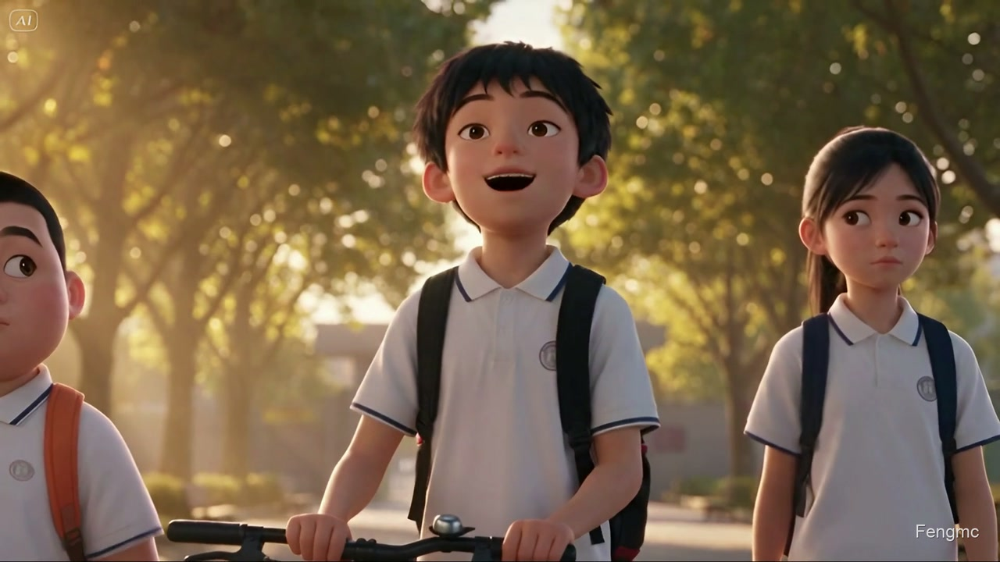
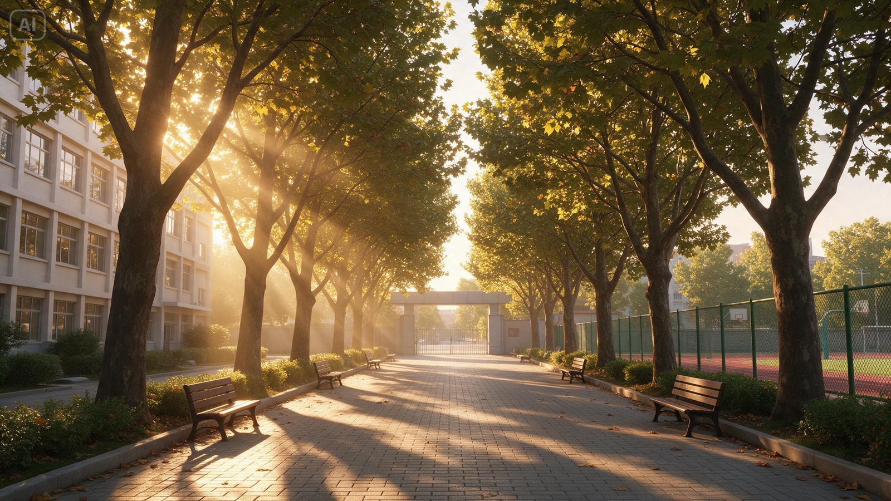

# 骑电动车的小争论

放学路上，林浩推着自行车，觉得天天骑车太累。他想换电动车，许诺提醒他注意上路年龄，张伟则觉得家长同意就可以。三个人把各自的理由说出来，最后一起作出更安全的选择。

[观看与下载完整视频](https://github.com/Fengmc2001/ai-video-workflow/releases/tag/v0.1.0)

成片52.13秒，1920×1080、60fps、中文同期声，右下角Fengmc水印。

## 人物

| 林浩 | 许诺 | 张伟 |
| --- | --- | --- |
|  |  |  |
| 自信、爱逞强，也愿意讲道理 | 认真、友善，关心朋友 | 憨厚活泼，先问问大家的想法 |

[人物资料](characters.json)记录外形、性格、声音和动作。[台词表](dialogue.json)将每句对白绑定到对应角色。

## 场景与道具

三人穿同款校服，靠发型、体态和书包颜色区分。林浩扶着深蓝色普通自行车；背景中的教学楼、围栏、长椅与暖金色夕阳维持同一套空间关系。

## 两段剧情

G1交代动机并展开分歧。开头一句“自行车天天骑着也太累了”让林浩的换车想法有了生活中的理由；随后，人物讨论技术好、路程近与规则之间的关系。

G2接上张伟提出的“家长允许”，许诺同时回应两位同学。最后，林浩和张伟分别说出自己的选择，再回到三人远景。

[分镜](storyboard.json) · [G1提示词](prompts/G1.md) · [G2提示词](prompts/G2.md) · [开场内容精修](prompts/opening-refinement.md)

## 生成与后期

人物与场景参考、两段视频使用Dreamina生成，声音来自视频同期声。G2参考G1末帧以及林浩、许诺的清晰原声。

下载官方60fps内插结果后，用RealESRGAN_x2plus按85%强度超分，再在本地处理开场声音、时间轴合成与水印。完整配方保存在[postproduction.json](postproduction.json)。

参考素材、台词和分镜都能通过同一份配置导出：

~~~bash
aivideo check examples/traffic-safety/project.json
aivideo prompts examples/traffic-safety/project.json --output workspaces/traffic-prompts
~~~

制作阶段的分镜设计为前后各约26秒，成片时间轴为52.133秒。
